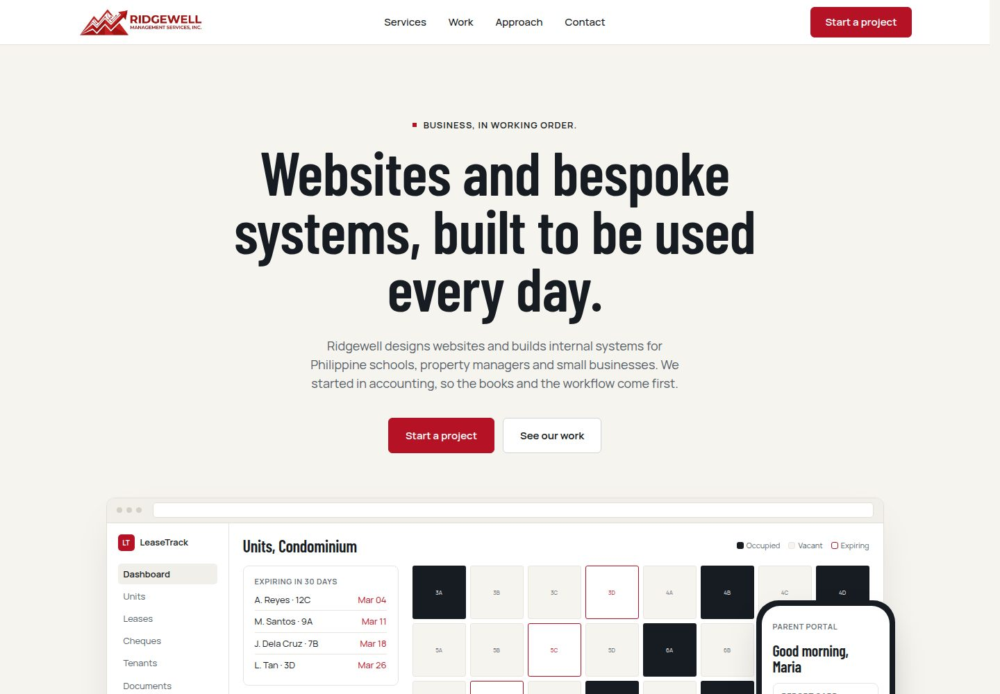

# Ridgewell

A React SPA redesign of [ridgewell.com.ph](https://ridgewell.com.ph) for Ridgewell Management Services, Inc.

The original logo and published contact address are retained. The page is the "Showroom" redesign: a warm off-white canvas, Barlow Condensed headlines, Manrope body, Ridgewell red as the only accent, and drawn product screens inside browser and phone frames that show the two services and seven systems in daily use. A keyboard-accessible page, native FAQ disclosures, and a reviewable email-draft inquiry flow support it.



## Run locally

Requires Node.js 24 (the CI version) and npm.

```sh
npm ci
npm run dev
```

## Verify

```sh
npx playwright install chromium
npm run check
```

`check` runs inquiry and content unit tests, TypeScript, the production build, and desktop/mobile Playwright tests including axe accessibility checks. Use `PLAYWRIGHT_CHROMIUM_EXECUTABLE_PATH` if your environment provides its own Chromium executable.

## Build and host

```sh
npm run build
npm run preview
```

Upload `dist/` to a static host. Assets use relative paths, and navigation uses real document anchors, so no server-side route rewrites or API server are needed. The production website and its DNS are not changed by this repository.

The GitHub verification workflow builds the app and publishes a downloadable `ridgewell-static-site` artifact. Deploy that artifact to your preferred static host after verification.

## Inquiry behavior

The form validates locally and prepares an email addressed to the address published by Ridgewell. The visitor reviews and sends the message in their own email app, or copies it into webmail. It does not claim a message was sent, connect to the original site's submission API, or save personal data in local storage. A server-backed inquiry form can replace this explicit handoff once its delivery contract is configured.

## Project guide

- `src/content.ts`: the page copy (hero, proof chips, two services, seven case studies, approach, about, questions, contact details) and the inquiry interest options. A few section labels and headings (Services, Questions), the Contact terms, the header, the footer and the form's labels and messages live in their components and `src/lib/inquiry.ts`.
- `src/lib/forbidden.ts`: words that must never appear on the page; enforced by `src/content.test.ts` and `tests/work.spec.ts`.
- `src/components/`: one component per section (`Hero`, `Services`, `Work`, `Approach`, `About`, `Questions`, `Contact`, `Footer`), the inquiry flow, `Frames.tsx` (browser and phone frames) and `Screen.tsx` with the drawn screens in `screens/`.
- `src/lib/inquiry.ts`: validation and email draft construction.
- `src/styles.css`, `src/components/screens.css`, `src/components/inquiry.css`: tokens and page, screen and form styles.
- `DESIGN.md`: design decisions and interaction contract.
- `docs/superpowers/specs/`: the approved concept spec; `docs/superpowers/plans/`: the implementation plan.

Original logo rights belong to Ridgewell. Font licenses are supplied by the Fontsource packages in `node_modules`. This repository makes no claim to ownership of the original brand assets.

## Replacing a drawn screen with a real screenshot

Every screen is rendered by `Screen` from a key in `src/content.ts`. To use a real, tightly cropped screenshot that contains no personal data, put the file in `public/work/` and add `image: { src: "./work/<file>.png", width, height }` to that case study. `Work.tsx` already passes it through: `<Screen kind={study.screen} alt={study.screenAlt} image={study.image} />`. The accessible name stays the same.

## Animation

GSAP settles headings by 12px, raises the hero frame by 24px and fades each card in once as it enters the viewport. Animations respect `prefers-reduced-motion`, including preference changes while the page is open. Motion lives in `src/hooks/useMotion.ts`, with React-scoped cleanup and browser regression coverage in `tests/motion.spec.ts`.
